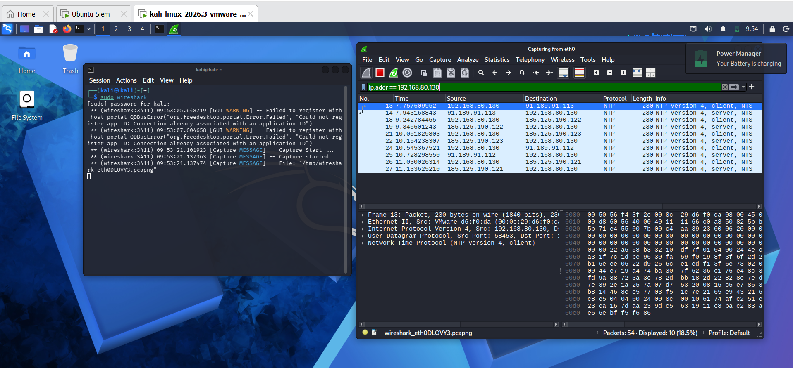
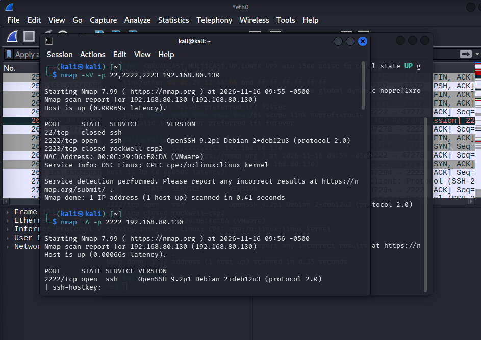
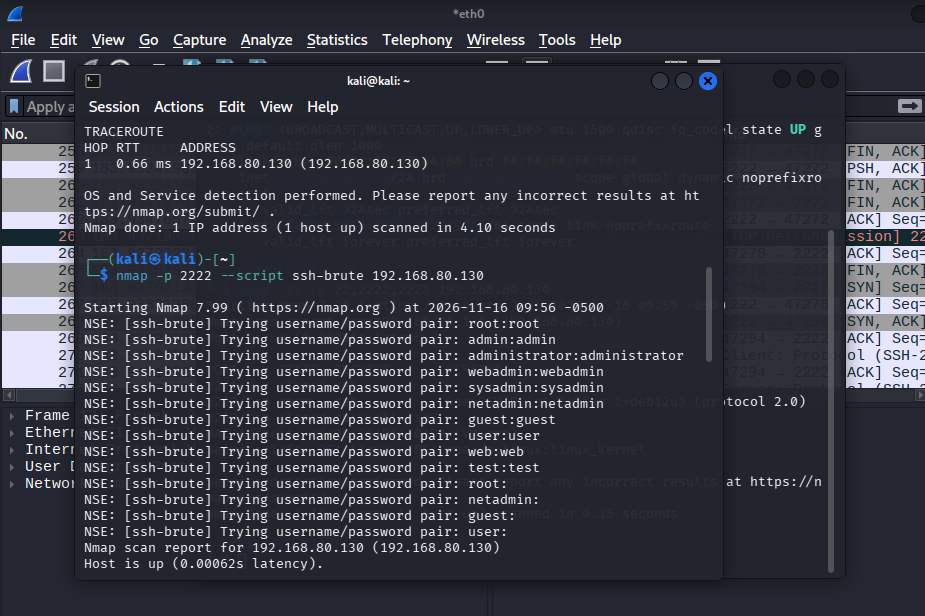
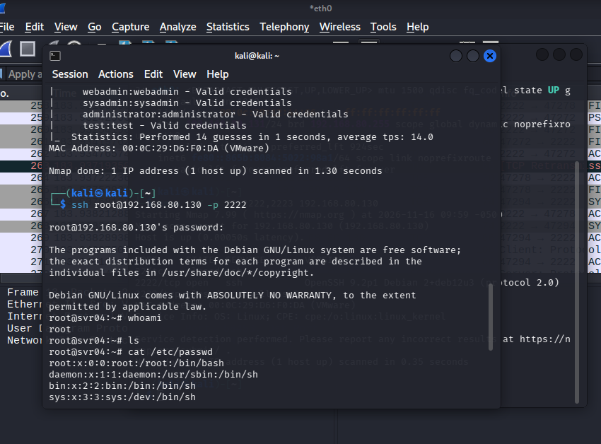
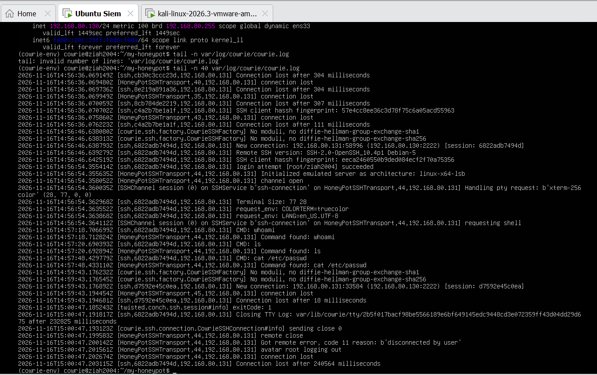

# Network Attack Detection & Reporting Lab

A hands-on lab simulating a network scan, SSH brute-force attack, and unauthorized login against a **Cowrie honeypot**, with full traffic capture in **Wireshark** and a written incident report.

**Author:** Faaiziat Akanni

---

## Overview

This project sets up two virtual machines — a Kali Linux "attacker" and an Ubuntu Server running the [Cowrie](https://github.com/cowrie/cowrie) SSH/Telnet honeypot — to demonstrate how a real intrusion attempt looks from both the attacker's and the defender's side.

- **Attacker VM:** Kali Linux (`192.168.80.131`)
- **Target VM:** Ubuntu Server running Cowrie honeypot (`192.168.80.130`, fake SSH on port `2222`)
- **Capture tool:** Wireshark (interface `eth0`)
- **Scan/attack tool:** Nmap (including the `ssh-brute` NSE script)

Because Cowrie is a decoy system, every "attack" in this repo was safely trapped and logged — no real system or data was at risk.

## What was done

1. **Reconnaissance** — `nmap -sV` and `nmap -A` against the target to identify open ports and service versions.
2. **Brute-force attempt** — `nmap -p 2222 --script ssh-brute` to test common username/password pairs against the fake SSH service.
3. **Manual login & post-exploitation** — SSH'd in with guessed credentials and ran `whoami`, `ls`, `cat /etc/passwd` inside the fake shell.
4. **Traffic capture** — Wireshark recorded the full exchange on `eth0` for the duration of the attack.
5. **Log review** — Cowrie's own logs were checked to confirm every scan and command was captured from the defender's side.

## Repository structure

```
network-attack-lab/
├── README.md
├── report/
│   └── Faaiziat-Akanni-assignment1.docx   # 1-page incident report + screenshot appendix
├── captures/
│   └── cowrie_attack.pcapng               # Full Wireshark packet capture
└── screenshots/
    ├── 01-wireshark-capturing.png
    ├── 02-nmap-scan-sV-A.png
    ├── 03-nmap-os-traceroute.png
    ├── 04-nmap-ssh-brute.png
    ├── 05-ssh-login-commands.png
    ├── 06-cowrie-status-ip.png
    ├── 07-cowrie-log-live.png
    ├── 08-cowrie-log-full.png
    └── 09-wireshark-pcap-review.png
```

## Evidence

- **Incident report:** [`report/Faaiziat-Akanni-assignment1.docx`](report/Faaiziat-Akanni-assignment1.docx)
- **Packet capture:** [`captures/cowrie_attack.pcapng`](captures/cowrie_attack.pcapng) — open with Wireshark to inspect every packet exchanged during the attack.

## Screenshots

**Wireshark capturing live traffic on `eth0`**


**Nmap scan — service/version detection**


**Nmap `ssh-brute` script testing credentials**


**Successful SSH login and commands run inside the fake shell**


**Cowrie log confirming the attack was recorded by the honeypot**


## Key findings

| Item | Detail |
|---|---|
| Attacker IP | `192.168.80.131` |
| Target service | Fake SSH (OpenSSH 9.2p1 Debian) on port `2222` |
| Credentials used | `root` / `ziah2004` |
| Commands run | `whoami`, `ls`, `cat /etc/passwd` |
| Detection | Fully captured by Wireshark and logged by Cowrie |

## Recommendations

- Block unknown/untrusted IPs from reaching SSH via firewall rules.
- Disable password-based root login; enforce SSH key authentication.
- Deploy Fail2Ban (or similar) to auto-block IPs after repeated failed logins.

## Tools used

- [Kali Linux](https://www.kali.org/)
- [Cowrie Honeypot](https://github.com/cowrie/cowrie)
- [Nmap](https://nmap.org/)
- [Wireshark](https://www.wireshark.org/)
